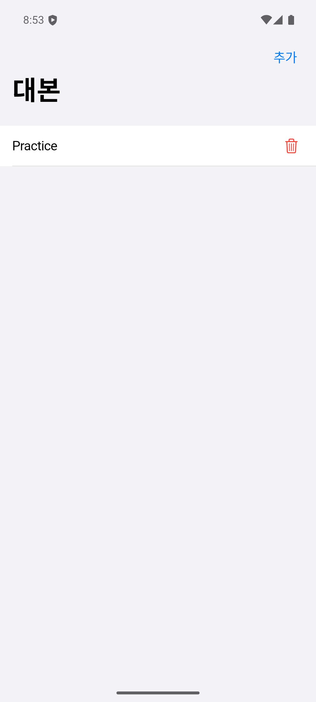
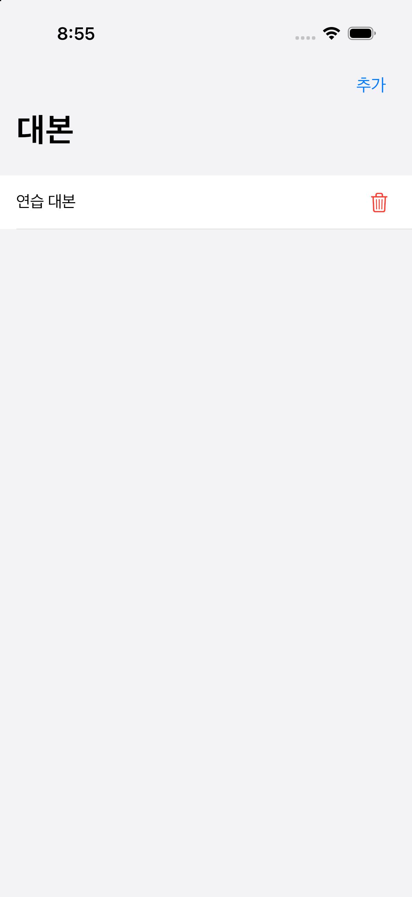
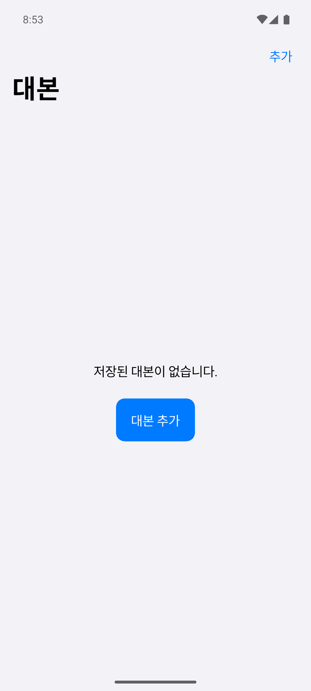
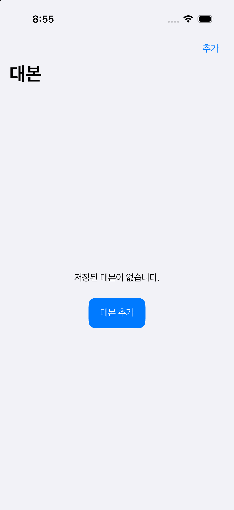
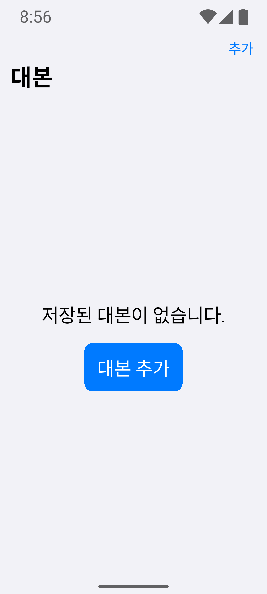
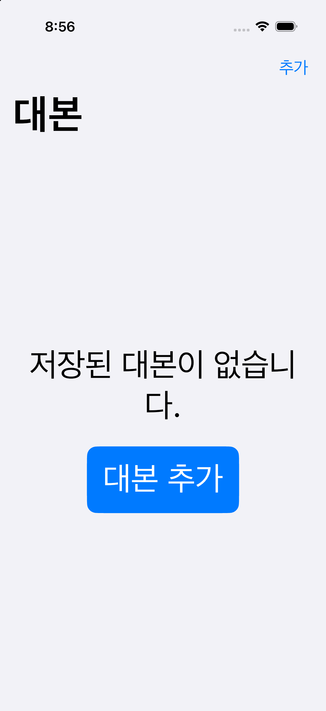
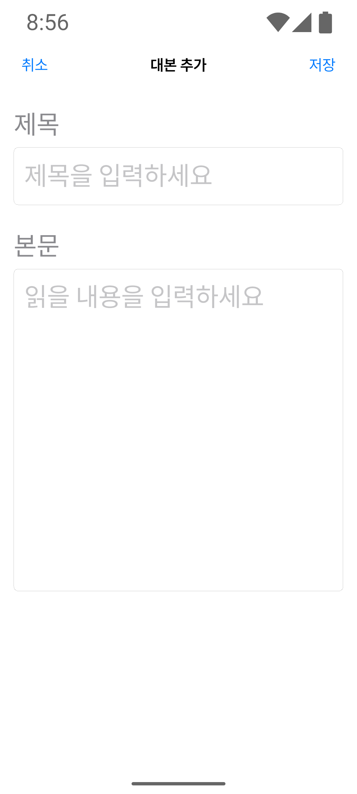
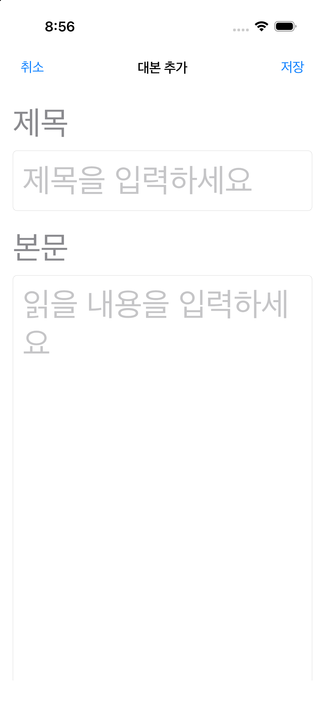

# Issue #28 대본 로컬 저장 검증

## 구현

- `scripts` schema version 1에 `id`, `title`, `body`, `created_at`, `updated_at`을 저장한다.
- 앱 조립 지점에서 `AppDatabase → DriftScriptService → LocalScriptRepository → ViewModel`을 주입한다.
- drift 행 타입은 infrastructure 밖으로 노출하지 않고 Repository에서 앱 `Script` 모델로 변환한다.
- 추가와 삭제는 drift의 watch query가 목록 ViewModel에 다시 전달하므로 별도 UI 캐시를 수정하지 않는다.
- DB 파일은 application support 디렉터리의 `maltto.sqlite`를 사용한다. 앱 시작 시 기존 파일을 열며 초기화나 삭제 코드는 두지 않았다.
- schema version을 올릴 때 `migrations/schema_migration.dart`에 버전별 데이터 보존 migration을 추가하도록 `onUpgrade` 경계를 분리했다. 등록되지 않은 migration은 DB를 재생성하지 않고 실패한다.

## 입력과 개인정보

- ViewModel과 Service에서 Dart `trim()` 기준 빈 제목·본문·공백뿐인 입력을 거부한다.
- 테이블에도 일반 공백, 탭, 줄바꿈, carriage return을 거부하는 CHECK 제약을 둔다.
- PRD와 Issue에는 긴 본문의 숫자 상한이 없으므로 임의 제한이나 잘라내기를 추가하지 않았다. 자동 테스트는 긴 직접 작성 더미 본문을 파일 DB에 저장한 뒤 재개방해 원문 전체가 같은지 확인한다.
- 사용자 제목·본문을 로그, 오류 문구, 분석 SDK, 네트워크로 보내는 코드는 없다.

## 자동 검증

- `dart format --output=none --set-exit-if-changed .`: 통과
- `flutter analyze`: 통과
- `flutter test`: 45개 통과
- `flutter build apk --debug`: 통과
- `flutter build ios --simulator --debug --no-codesign`: 통과
- `scripts/check_public_repo.sh`: 통과

drift 테스트는 메모리 SQLite CRUD·watch 갱신·공백 검증을 확인한다. 파일 SQLite 테스트는 DB 연결을 닫고 같은 파일을 새 연결로 다시 열어 제목, 긴 본문, 생성 시각이 보존되는지 확인한다.

## 양 플랫폼 실행 검증

- Android 16/API 36 임시 Emulator에서 추가 → 목록 표시 → 프로세스 강제 종료 → 재실행 후 유지 → 삭제 확인 → 빈 상태 복귀를 수행했다.
- iPhone 17 Pro/iOS 26.3 Simulator에서 같은 흐름을 수행했고, 재실행 뒤 접근성 트리에도 저장한 제목이 남는 것을 확인했다.
- Android는 글꼴 배율 200%, iOS는 `accessibility-extra-large`에서 빈 상태와 추가 화면을 확인했다. 핵심 문구와 조작이 잘리거나 겹치지 않고, 입력 화면은 세로 스크롤 구조를 유지했다.
- 위젯 테스트에서 삭제와 빈 상태 추가 조작의 48 logical pixel 터치 영역, 삭제 Semantics, 긴 제목 줄바꿈을 확인했다.

### 기본 글씨

| Android | iOS |
|---|---|
|  |  |
|  |  |

### Accessibility XL

| Android 200% | iOS Accessibility XL |
|---|---|
|  |  |
|  |  |
