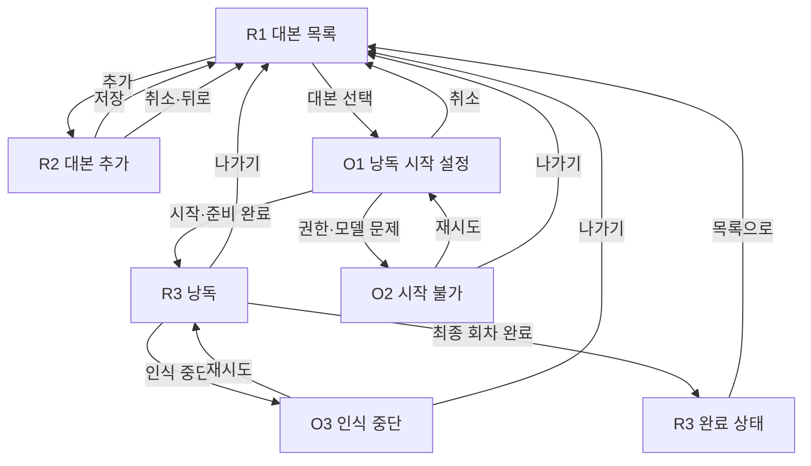

# MVP 최소 화면과 핵심 플로우

> Issue #15 산출물. `docs/PRD.md`의 화면 요구사항을 디자인·개발이 같은 흐름으로 구현할 수 있도록 구체화한다.
> 각 항목은 **확정** 또는 **제안**으로 표시한다. 제안은 Marco의 PR 리뷰 전까지 확정으로 취급하지 않는다.

## 1. 화면 구성

### 화면 최소화 원칙 — 확정

- 독립 라우트는 대본 목록, 대본 추가, 낭독의 세 개만 둔다.
- 반복 횟수 선택은 목록 위의 시작 설정 시트로 제공한다.
- 완료는 별도 화면으로 이동하지 않고 낭독 화면의 완료 상태로 표시한다.
- 권한·모델·인식 오류는 별도 설정 화면을 만들지 않고 발생한 화면에서 안내한다.
- 온보딩, 계정, 설정 탭, 도움말 화면을 MVP에 추가하지 않는다.

| ID | 형태 | 이름 | 주목적 | 상태 |
|---|---|---|---|---|
| R1 | 라우트 | 대본 목록 | 저장된 대본 선택·추가·삭제 | 확정 |
| R2 | 라우트 | 대본 추가 | 제목·본문 입력과 저장 | 확정 |
| R3 | 라우트 | 낭독 | 음성 진행·후퇴·반복·완료 | 확정 |
| O1 | 시트 | 낭독 시작 설정 | 반복 횟수 선택과 시작 | 제안 |
| O2 | 안내 | 시작 불가 | 권한·모델·서비스 문제 안내 | 확정 |
| O3 | 안내 | 인식 중단 | 재시도 또는 안전한 나가기 | 제안 |

## 2. 전체 흐름

### 전진 규칙 — 확정

- 사용자의 음성과 일치한 STT 결과만 낭독 커서를 앞으로 이동시킨다.
- 화면 탭, 스와이프, 버튼, 시간 경과, 재시도는 커서를 앞으로 이동시키지 않는다.
- `한 어절 뒤로`는 현재 커서를 정확히 한 어절 뒤로만 이동시킨다.
- 마지막 어절과 최종 회차 완료는 일치한 STT 결과에서만 발생한다.

## 3. R1 대본 목록

### 화면 목적 — 확정

저장된 대본을 선택해 낭독을 시작하거나 새 대본을 추가하고, 더 이상 필요 없는 대본을 삭제한다.

### 화면 요소

| 요소 | 동작 | 상태 |
|---|---|---|
| 화면 제목 | 중립적인 `대본` 문구를 표시한다. | 확정 |
| 대본 목록 | 제목만 표시하고 선택하면 O1을 연다. | 확정 |
| 추가 버튼 | R2로 이동한다. | 확정 |
| 삭제 동작 | 선택한 대본의 삭제 확인을 연다. | 확정 |
| 빈 상태 | 안내 문구와 추가 버튼만 표시하며 샘플 대본을 넣지 않는다. | 확정 |

### 상태별 동작

| 상태 | 사용자에게 보이는 것 | 가능한 행동 | 상태 |
|---|---|---|---|
| 대본 없음 | 빈 상태 안내와 추가 버튼 | 추가 | 확정 |
| 대본 있음 | 저장된 제목 목록과 추가 버튼 | 선택, 삭제, 추가 | 확정 |
| 불러오기 실패 | 데이터가 사라진 것처럼 빈 목록을 표시하지 않고 오류 안내 | 재시도 | 제안 |
| 삭제 확인 | 삭제 대상 제목과 취소·삭제 | 취소, 삭제 | 확정 |

### 뒤로가기 — 확정

- R1은 앱의 루트다.
- 시스템 뒤로가기는 Android에서 앱 종료 기본 동작을 따르고, iOS에는 별도 뒤로 버튼을 표시하지 않는다.

## 4. R2 대본 추가

### 화면 목적 — 확정

사용자가 제목과 본문을 직접 입력해 기기에 저장한다.

### 화면 요소

| 요소 | 동작 | 상태 |
|---|---|---|
| 제목 입력 | 단일 제목을 입력한다. | 확정 |
| 본문 입력 | 여러 줄 대본을 입력한다. | 확정 |
| 저장 | 유효한 입력을 로컬 저장하고 R1로 돌아간다. | 확정 |
| 취소·뒤로 | 저장하지 않고 R1로 돌아간다. | 확정 |

### 입력과 이탈

| 조건 | 기대 동작 | 상태 |
|---|---|---|
| 제목 또는 본문이 공백뿐임 | 저장하지 않고 해당 입력 근처에 이유를 안내한다. | 제안 |
| 입력하지 않고 취소·뒤로 | 확인 없이 R1로 돌아간다. | 제안 |
| 입력 후 취소·뒤로 | `작성 중인 내용을 버릴까요?` 확인을 제공한다. | 제안 |
| 저장 성공 | R1에 새 제목이 나타난다. | 확정 |
| 저장 실패 | 입력을 유지하고 같은 화면에서 재시도할 수 있다. | 제안 |

### 저작권·개인정보 — 확정

- 기본 본문, 예시 문장, 제3자 텍스트를 입력란에 미리 채우지 않는다.
- 붙여넣기는 사용자가 직접 수행하며 특정 출처에서 텍스트를 가져오지 않는다.
- 입력 내용은 서버나 분석 도구로 보내지 않는다.

## 5. O1 낭독 시작 설정

### 표시 방식 — 제안

R1에서 대본을 선택하면 Cupertino 스타일의 시트를 연다. 별도 라우트로 이동하지 않아 목록 맥락과 선택한 대본을 유지한다.

### 화면 요소

| 요소 | 동작 | 상태 |
|---|---|---|
| 선택한 대본 제목 | 시작할 대본을 확인한다. | 확정 |
| 반복 횟수 | 1~10회 중 하나를 선택하며 기본값은 1회다. | 제안 |
| 시작 | 준비 검사를 실행하고 통과하면 R3로 이동한다. | 확정 |
| 취소·뒤로 | 시트를 닫고 R1을 유지한다. | 확정 |

### 시작 순서 — 확정

1. 사용자가 시작을 누른다.
2. 마이크·음성 인식 권한 상태를 확인한다.
3. 한국어 로케일과 온디바이스 모델·서비스 사용 가능 여부를 확인한다.
4. 필요한 권한이 미결정이면 O2의 사전 안내 뒤 시스템 권한 요청을 표시한다.
5. 모든 조건이 준비된 경우에만 R3를 열고 STT를 시작한다.
6. 준비되지 않은 경우 O2를 표시하며 낭독 세션과 반복 카운트를 만들지 않는다.

## 6. O2 시작 불가 안내

### 공통 원칙 — 확정

- 수동으로 다음 어절을 넘기는 대체 동작을 제공하지 않는다.
- 지원 여부를 숨기고 네트워크 STT로 전환하지 않는다.
- 문제 원인, 사용자가 할 수 있는 조치, 안전한 나가기를 함께 제공한다.

| 원인 | 주 행동 | 보조 행동 | 상태 |
|---|---|---|---|
| 권한 미결정 | 권한 요청 계속 | 취소 | 제안 |
| 권한 거부 | 시스템 설정 열기 | 나가기 | 확정 |
| 온디바이스 모델 준비 필요 | 플랫폼이 제공하는 준비 절차 안내 | 나가기 | 제안 |
| 한국어·서비스 미지원 | 지원되지 않음을 안내 | 나가기 | 확정 |
| 일시적인 준비 실패 | 다시 확인 | 나가기 | 제안 |

설정 앱에서 돌아왔을 때 자동으로 낭독을 시작하지 않는다. 사용자가 O1에서 다시 시작해야 한다. — **제안**

## 7. R3 낭독

### 화면 목적 — 확정

현재 어절과 반복 상태를 명확히 보여주고, 사용자 음성에 따라 낭독을 끝까지 진행한다.

### 정보 우선순위

| 순위 | 요소 | 표시 규칙 | 상태 |
|---|---|---|---|
| 1 | 대본과 현재 어절 | 화면의 주 영역을 사용하고 현재 어절이 보이도록 자동 스크롤한다. | 확정 |
| 2 | 현재 반복 | 목표가 2회 이상일 때 `현재/전체`를 표시한다. | 확정 |
| 3 | 한 어절 뒤로 | 항상 접근 가능한 하단 조작으로 제공한다. | 확정 |
| 4 | 나가기 | 항상 접근 가능하되 전진 조작처럼 보이지 않게 분리한다. | 확정 |
| 5 | 경과 시간 | 세션 중 표시하고 저장하지 않는다. | 제안 |

### 어절 상태 — 확정

- 완료: 현재 커서보다 앞에서 이미 읽은 어절
- 현재: 다음에 일치해야 하는 한 어절
- 대기: 현재 커서 뒤의 아직 읽지 않은 어절
- 세 상태는 색상만이 아니라 굵기, 장식, 접근성 상태값 중 하나 이상으로 구분한다.
- 현재 어절이 바뀔 때만 필요한 만큼 스크롤한다.

### 조작

| 조작 | 결과 | 제한 | 상태 |
|---|---|---|---|
| 음성 낭독 | 일치한 어절까지 커서를 앞으로 진행 | 현재 이후 제한 구간만 비교 | 확정 |
| 한 어절 뒤로 | 커서를 정확히 한 어절 뒤로 이동 | 첫 어절에서는 변화 없음 | 확정 |
| 나가기 | 마이크와 STT를 종료하고 R1로 이동 | 세션 진행 상태를 저장하지 않음 | 확정 |
| 시스템 뒤로 | 나가기와 동일하게 마이크와 STT를 종료하고 R1로 이동 | 직접 pop하기 전에 자원 종료 | 확정 |
| 대본 탭·스크롤 | 읽기 위치를 보거나 수동 스크롤 | 커서와 반복 상태를 변경하지 않음 | 확정 |

### 반복 전환 — 확정

1. 마지막 어절 일치 결과를 한 번만 처리한다.
2. 현재 회차를 완료한다.
3. 남은 회차가 있으면 STT를 중단하고 이전 전사 구간을 폐기한다.
4. 현재 커서를 첫 어절로, 현재 회차를 다음 값으로 변경한다.
5. 새 인식 세대를 시작하고 낭독을 계속한다.
6. 목표 회차를 마쳤으면 STT와 마이크를 종료하고 완료 상태로 전환한다.

## 8. O3 인식 중단 안내

### 진입 조건 — 제안

- STT 작업이 오류로 종료됨
- 오디오 세션 충돌로 입력을 계속 받을 수 없음
- 앱이 백그라운드로 이동했다가 전경으로 복귀함

### 기대 동작 — 확정

- 오류가 발생한 즉시 마이크와 기존 STT 작업을 중단한다.
- 현재 어절과 반복 회차를 유지한다.
- 오류 때문에 커서나 회차를 완료하지 않는다.
- 종료된 인식 세대의 늦은 결과를 폐기한다.

| 행동 | 결과 | 상태 |
|---|---|---|
| 재시도 | 새 인식 세대로 STT를 다시 시작하고 같은 위치에서 계속한다. | 제안 |
| 나가기 | 세션을 종료하고 R1로 돌아간다. | 확정 |

## 9. R3 완료 상태

### 표시 방식 — 제안

별도 완료 라우트를 만들지 않고 R3의 대본 영역을 완료 안내로 전환한다.

### 진입 시 보장 — 확정

- STT 구독, 네이티브 작업, 마이크가 종료돼 있다.
- 늦게 도착한 결과가 커서나 반복 횟수를 바꾸지 않는다.
- 완료 회차가 중복 증가하지 않는다.

| 요소 | 동작 | 상태 |
|---|---|---|
| 완료 안내 | 목표 횟수만큼 낭독했음을 알린다. | 확정 |
| 완료한 반복 횟수 | 최종 횟수를 표시한다. | 제안 |
| 경과 시간 | 현재 세션의 최종 시간을 표시하되 저장하지 않는다. | 제안 |
| 목록으로 | 명시적으로 R1로 돌아간다. | 제안 |

완료 직후 자동으로 목록으로 이동하지 않는다. 사용자가 결과를 인지하고 직접 돌아간다. — **제안**

## 10. 뒤로가기·나가기 규칙 요약

| 현재 위치 | 뒤로가기·취소 결과 | 확인 필요 | 상태 |
|---|---|---|---|
| R1 목록 | Android 앱 종료, iOS 동작 없음 | 없음 | 확정 |
| R2 추가 — 입력 없음 | R1 복귀 | 없음 | 제안 |
| R2 추가 — 입력 있음 | R1 복귀 | 작성 내용 폐기 확인 | 제안 |
| O1 시작 설정 | 시트 닫기, R1 유지 | 없음 | 확정 |
| O2 시작 불가 | O1 또는 R1 복귀 | 없음 | 확정 |
| R3 낭독 중 | STT·마이크 종료 후 R1 복귀 | 없음 | 확정 |
| O3 인식 중단 | R1 복귀 | 없음 | 제안 |
| R3 완료 | R1 복귀 | 없음 | 제안 |

## 11. 접근성·플랫폼 공통 기준

### 확정

- 텍스트 배율이 커져도 주 행동과 현재 어절을 가리지 않는다.
- 최소 터치 영역은 iOS 44pt × 44pt, Android 48dp × 48dp다.
- 아이콘만 있는 버튼에는 의미 있는 Semantics 라벨을 제공한다.
- 현재 어절, 반복 회차, 오류, 완료 상태를 VoiceOver·TalkBack으로 알 수 있다.
- 포커스는 시트·안내가 열리면 그 안으로 이동하고 닫히면 진입시킨 조작으로 돌아간다.
- Reduce Motion에서는 자동 스크롤과 상태 전환의 불필요한 애니메이션을 줄인다.
- iOS와 Android의 시스템 뒤로가기 표현은 다를 수 있지만 결과 상태는 이 문서와 같아야 한다.

## 12. 구현·검증 연결

| 흐름 | 구현 Issue | 디자인·QA Issue |
|---|---|---|
| R1·R2 대본 목록과 추가 | #28 | #21, #33 |
| O1 반복 선택 | #29 | #20, #21, #33 |
| R3 어절 진행·후퇴 | #25, #30 | #20, #21, #33 |
| 반복 전환·완료 | #29, #30 | #21, #33 |
| iOS STT 상태 | #26, #31 | #33 |
| Android STT 상태 | #12, #27, #31 | #33 |
| 나가기·백그라운드·늦은 결과 | #23, #26, #27, #29, #30, #31 | #33 |

## 13. 제품 방향 확인 항목

| 항목 | 제안 | 확정 방법 |
|---|---|---|
| 화면 수 | 라우트 3개 + 시트·안내 상태 | Marco의 #15 PR 리뷰 |
| 반복 횟수 | 1~10회, 기본 1회 | Marco의 #15 PR 리뷰 |
| 1회 회차 표시 | 생략 | Marco의 #15 PR 리뷰 |
| 완료 전환 | R3 내부 상태, 자동 복귀 없음 | Marco의 #15 PR 리뷰 |
| 경과 시간 | 낭독·완료에 표시하되 저장하지 않음 | Marco의 #15 PR 리뷰 |

이 항목들은 MVP 범위를 늘리지 않으며, 별도 사용자 결정을 새로 만들지 않고 PR 리뷰에서 방향을 확인한다.
